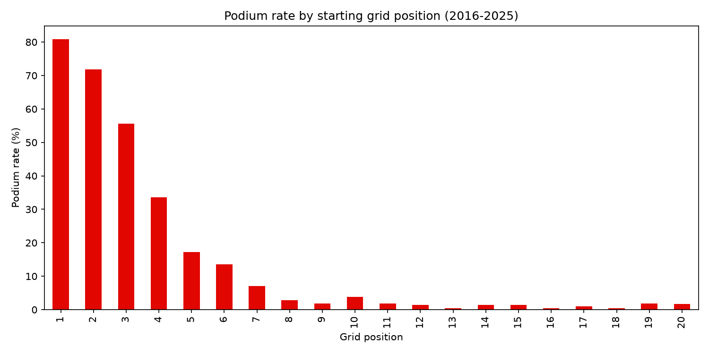
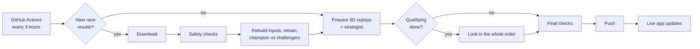

# F1 Podium Predictor


A Formula 1 machine learning app that runs itself. It predicts the **whole finishing order** of every race, locks the prediction in on race day (after qualifying and grid penalties), scores it after the race and retrains on the new result, with no human in the loop. Around the model sit 3D race replays, a pit-stop strategist and two games.

**Try it live: [f1-podium-predictor1.streamlit.app](https://f1-podium-predictor1.streamlit.app/)**

## What's in the app

| Page | What it does |
|---|---|
| **Home** | The next race at a glance: a live countdown with the five start lights, the weekend schedule in your own time, our model's locked podium. |
| **Podium Predictor** | Pick any race since 2016: the predicted podium with win and podium chances, the whole predicted order 1–22, *why* the model picked each podium driver, and the real result. |
| **Scoreboard** | Every live prediction, locked in before the race and scored after it, against the starting grid. Each race opens up to the full predicted order with a verdict for every driver. |
| **Season Rewind** | A whole season race by race, as the model would have called it. |
| **Pit Wall** | Any race since 2023 replayed on the real 3D track, with every car, and our strategist calling pit stops on team radio. |
| **Replay Commentary** | A 🎙 button on the Pit Wall replay: overtakes, lead changes, stops, retirements, safety cars and the finish turned into varied commentary lines, shown on screen and read out by the browser's own voice. No AI service. |
| **Ghost Lap Duel · Circuit Explorer · Tyre Lab** | Two drivers' fastest laps head to head, every circuit in 3D with real elevation, and tyre wear measured from real laps. |
| **Where the Race Was Won · Lap One · Team Radio** | Any two drivers' gap split into the start, pit stops, safety cars and racing laps; places gained on lap one, measured fairly; and every published radio message transcribed (open-source Whisper) and sorted by topic. |
| **Model Report Card · Rules Sandbox** | How trustworthy the model's percentages are (calibration, Brier score against a grid baseline, finish ranges), and every title since 1950 recomputed under any points system. |
| **Car DNA** | Each team's fastest race lap measured: slow, medium and fast corner speeds, top speed and traction from the telemetry, plus downforce, drag and power from fitting the lap simulator. |
| **AI Strategist** | A reinforcement-learning agent (cross-entropy policy search) learns each race's pit strategy from thousands of simulated races, including when to box early for a safety car, and takes on the best fixed plan and the real winner's stops. |
| **Failure Watch** | Did a car's lap times warn of trouble before it retired? Lap-by-lap residuals against fuel- and tyre-corrected pace, with an honest test over every race since 2023 of how many retirements it catches and how often it cries wolf. |
| **Ask the Pit Wall** | Plain-English questions about F1 since 1950 (wins, poles, titles, head-to-heads, race results), read with fuzzy name matching and answered from our own archive. No language model. |
| **Guess the Driver** | Two teammates' laps from the same race: whose is whose? A model trained on 16 driving habits from OpenF1 car data (braking points, throttle pickup, coasting, shift points), measured against the team's own average so the car cancels out, then tested on races it never saw. |
| **Race the AI Driver** | Drive a real circuit yourself in the browser, on the lap simulator's physics, against an AI driver learned from real laps (behaviour cloning, tested on circuits it never saw) and the real fastest lap. |
| **Race Films** | The story of any race since 2023 written scene by scene from its data (start, lead changes, safety cars, stops, the finish) and read aloud by the browser's own voice. |
| **Classic Races · Race Director** | Six famous races since 1996 rebuilt from Jolpica lap times to replay with your own strategy; and 400+ real incidents from race control to judge before seeing the stewards' decision. |
| **All-Time Ratings · Driver Swap** | A driver-vs-car model fitted on every race since 1950, ranking drivers with the car taken out (against their own era or on one scale), and putting any driver in any car to replay that season. |
| **Win Probability · Rain Crossover** | Every driver's odds through a real race, replayed from each lap's real positions; and in wet races, when slicks beat intermediates and who switched at the right time. |
| **Race Simulator · 3D Part Explorer** | A whole Grand Prix replayed 400 times lap by lap (tyres, fuel, pit stops, overtaking, safety cars, retirements) so you can change a strategy and see the odds move; and the car, its wings, power unit, a wheel corner and the floor in 3D, explodable part by part. |
| **Historic Circuits** | The Nordschleife and the old Hockenheim (1970s–2001, with its forest straights) rebuilt from OpenStreetMap (© OpenStreetMap contributors, ODbL) with real elevation, and a 1975, a 2001 and a 2026 car racing round it on the lap simulator, each older car tuned to a real pole lap of its era. |
| **Feeder Series · Superlicence Calculator** | Formula 2 (and GP2), Formula 3 (and GP3) and F1 Academy since 2005, read from Wikipedia's season articles (CC BY-SA 4.0): every championship, every champion and who reached F1; and the FIA Super Licence points, with a path planner and who on the ladder has the 40 points. |
| **Scouting Report** | Which F2/GP2 and F3/GP3 records turned into F1 careers: a logistic regression on each driver's feeder record, tested on eras it never saw (it ranks who reaches F1 with an AUC of about 0.92, and its percentages hold up), plus who looks next and the closest past records. |
| **Career Mode** | From F4 at 15 to F1: pick a team and how hard to push each season; every year is a real driver-season from the same kind of seat, the Super Licence uses the FIA's table, F1 teams judge you with the Scouting Report's model, and the money has to last. |
| **Other Series · Series Compare** | Formula E and IndyCar championships with each driver's F1 story; and one circuit lapped by an F1, F2, F3, Formula E and IndyCar-style car, with F2 and F3 tuned to the real poles of their F1-weekend races (about 2.6% off on circuits left out). |
| **Calendar Planner** | How far F1 travels in any season since 1950 and an estimate of its freight carbon, with a shorter order for the same races found by simulated annealing, keeping chosen races on their dates and limiting how far the rest may move. |
| **Pit Crew** | Run a pit stop yourself (the jack, four wheel guns, a safe release into the lane) and see where your stationary time ranks among every stop OpenF1 timed. |
| **Qualifying Game** | Q1, Q2 and Q3 against the real laps of a real session: choose when to run, whether to chase a tow and how hard to push, with the track getting faster at the rate measured in that session and the real cut lines deciding who goes through. |
| **Circuit Designer** | Draw your own circuit by dragging points; the lap simulator, running in the browser, drives it as you draw with a typical calibrated car of the season: lap time, top speed, braking zones and overtaking spots. |
| **Wind Tunnel · Engine Penalty Planner** | A live 2D airflow simulation (lattice-Boltzmann) running in the browser, and where to fit new power units for the cheapest grid penalties, from how much a grid place costs at each circuit. |
| **Energy Lab · Porpoising Lab · Dirty Air Lab · Engine Room** | The battery round a lap (harvest, deploy, clipping) with your own deployment plan; why ground-effect cars bounced; what following another car costs; and F1 engines through the eras with their sound synthesised live. |
| **Tyre Physics** | The magic formula, load sensitivity, the friction circle with the real g-g of any lap, and a tyre temperature window you control. |
| **Lap Simulator · Setup Garage** | A physics lap simulator calibrated on every race's fastest lap: watch it drive the real 3D track beside the real lap, then change the wing, power, weight or tyres and see the lap time corner by corner. |
| **Engineering Academy** | A course on how an F1 car works, from the tyres up, in three depths, with live demos on the simulator and real data. Modules 0–7 and 11–13 are open (Module 13 rides every circuit in 3D, corner by corner); 17 modules are planned. |
| **Beat the AI** | Visitors pick the podium before the race, share a card, and find out after the race whether they beat the model. |
| **Be the Race Engineer** | Make the pit calls for a real driver in a real race and try to beat their team and our strategist. |
| **About** | Everything behind the app, sorted: the model, how it is tested, the strategist, the live system. |

Dark and light themes, works on phones.

## How the model works

Every driver gets a **strength score**, a weighted sum of what is known before the race: grid and qualifying position, the car's pace that weekend, recent form, season form, career and circuit records, reliability and racecraft. Every input is compared with the rest of the same race, so the model learns who is better than whom.

The finishing order is then modelled the way races work: who comes out on top, then who is best of the rest, and so on. This is a **Plackett-Luce ranking model**, fitted by maximum likelihood (SciPy) on the first 10 finishers of each race. To turn strengths into chances, each race is replayed 5,000 times with a measured amount of luck, so win chances add up to 100% and podium chances to exactly 3 drivers.

Because the model is linear, every prediction can be explained exactly. That's where **"Why this pick?"** comes from: the biggest reasons behind each podium driver, in plain words.

**Champion vs challengers:** a few model recipes take the same fair test every time new results come in. A challenger only replaces the live model if it is clearly better (at least 0.05 more podium drivers per race and no worse on the whole order). Every decision is logged.

## Results, tested fairly

Each season below was predicted by a model trained **only on the seasons before it**, so it never saw those results. "The grid" means guessing the race finishes in starting order, a tough baseline in F1. "Old model" is this project's first version, a Random Forest that only picked the podium.

| Season | Races | Podium drivers right per race: model | grid | old model | Winners called: model | grid | Places off (whole order): model | grid |
|---|---|---|---|---|---|---|---|---|
| 2026 (so far) | 19 | **1.95** | 1.84 | 1.84 | **74%** | 68% | 3.47 | 3.47 |
| 2025 | 24 | **2.42** | 2.25 | 2.29 | 58% | **67%** | **3.24** | 3.34 |
| 2024 | 24 | **2.08** | 2.00 | 1.96 | **50%** | 46% | **2.78** | 2.90 |
| 2023 | 22 | 1.73 | **1.91** | 1.91 | 64% | 64% | **3.46** | 3.75 |
| 2022 | 22 | **2.18** | 1.91 | 1.95 | 41% | **45%** | **3.65** | 3.94 |
| **All** | 111 | **2.07** | 1.98 | 1.99 | 57% | 58% | **3.32** | 3.48 |

**Honest reading:** the model beats the grid on podium picks in four of five seasons and is better or level on the whole order every season, but the edge is small, and in 2023 the grid was better. Qualifying already tells you most of what matters on Sunday. From São Paulo 2026 onwards, the Scoreboard tracks predictions locked in before each race, which is the most honest test of all.



## How it runs itself



**Rules that keep it honest:**
- A prediction is saved on race day, 8 hours before lights out, with the real qualifying results and the known grid penalties. Once saved, it is never changed, and every run checks that.
- Every input is built only from races before the one being predicted.
- The pit strategist only knows the laps that have happened. The code refuses to run if it is handed a future lap, and every run tests this.

**Safety checks:** no results lost, missing or duplicated; exactly one P1, P2 and P3 per race; a healthy model score; complete replay files. If any check fails, the run stops, nothing is pushed, and I get an email.

## Data

- [Jolpica-F1](https://github.com/jolpica/jolpica-f1) (the Ergast successor): results, grids and qualifying since 2016, and the calendar
- [OpenF1](https://openf1.org): laps, tyres, pit stops, race control and car positions, 2023 onwards
- MultiViewer circuit data: official corner numbers

## Built with

Python, pandas, NumPy, SciPy, scikit-learn · Streamlit and Altair · Three.js for the 3D pages · GitHub Actions · Supabase for Beat the AI picks (reached only from the app's server).

## Run it yourself

```bash
git clone https://github.com/abeeryaseer24/f1-podium-predictor.git
cd f1-podium-predictor
python -m venv .venv
source .venv/Scripts/activate      # on Mac/Linux: source .venv/bin/activate
pip install -r requirements-dev.txt
streamlit run app.py
```

Rebuild everything, or run the robot by hand:

```bash
python src/data_loader.py && python src/features.py && python src/train.py
python src/pipeline.py                     # what GitHub Actions runs every 3 hours
python src/lapsim.py --all                 # calibrate the lap simulator on every prepared race
python src/checks.py                       # all safety checks
```

Beat the AI works without a database (picks are saved locally). To use Supabase, add `.streamlit/secrets.toml`:

```toml
[supabase]
url = "https://your-project.supabase.co"
key = "your-secret-key"
```
