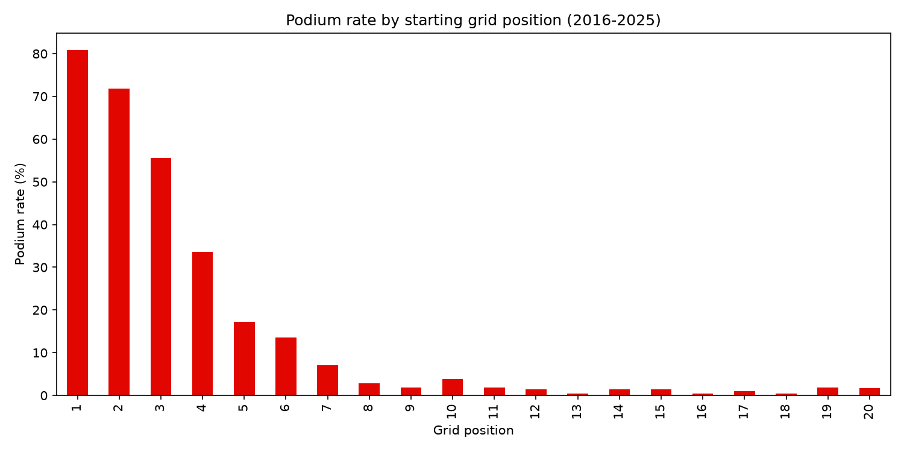
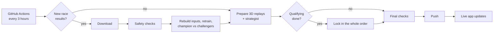

# F1 Podium Predictor


A Formula 1 machine learning app that runs itself. It predicts the **whole finishing order** of every race, locks the prediction in on race day (after qualifying and grid penalties), scores it after the race and retrains on the new result, with no human in the loop. Around the model sit 3D race replays, a pit-stop strategist and two games.

**Try it live: [f1-podium-predictor1.streamlit.app](https://f1-podium-predictor1.streamlit.app/)**

## What's in the app

| Page | What it does |
|---|---|
| **Home** | The next race at a glance: a live countdown with the five start lights, the weekend schedule in your own time, our model's locked podium. |
| **Podium Predictor** | Pick any race since 2016: the predicted podium with win and podium chances, the whole predicted order 1–22, *why* the model picked each podium driver, and the real result. |
| **Scoreboard** | Every live prediction, locked in before the race and scored after it, against the starting grid. Each race opens up to the full predicted order with a verdict for every driver. |
| **Season Rewind** | A whole season race by race, as the model would have called it. |
| **Pit Wall** | Any race since 2023 replayed on the real 3D track, with every car, and our strategist calling pit stops on team radio. |
| **Ghost Lap Duel · Circuit Explorer · Tyre Lab** | Two drivers' fastest laps head to head, every circuit in 3D with real elevation, and tyre wear measured from real laps. |
| **Beat the AI** | Visitors pick the podium before the race, share a card, and find out after the race whether they beat the model. |
| **Be the Race Engineer** | Make the pit calls for a real driver in a real race and try to beat their team and our strategist. |
| **About** | Everything behind the app, sorted: the model, how it is tested, the strategist, the live system. |

Dark and light themes, works on phones.

## How the model works

Every driver gets a **strength score**, a weighted sum of what is known before the race: grid and qualifying position, the car's pace that weekend, recent form, season form, career and circuit records, reliability and racecraft. Every input is compared with the rest of the same race, so the model learns who is better than whom.

The finishing order is then modelled the way races work: who comes out on top, then who is best of the rest, and so on. This is a **Plackett-Luce ranking model**, fitted by maximum likelihood (SciPy) on the first 10 finishers of each race. To turn strengths into chances, each race is replayed 5,000 times with a measured amount of luck, so win chances add up to 100% and podium chances to exactly 3 drivers.

Because the model is linear, every prediction can be explained exactly. That's where **"Why this pick?"** comes from: the biggest reasons behind each podium driver, in plain words.

**Champion vs challengers:** a few model recipes take the same fair test every time new results come in. A challenger only replaces the live model if it is clearly better (at least 0.05 more podium drivers per race and no worse on the whole order). Every decision is logged.

## Results, tested fairly

Each season below was predicted by a model trained **only on the seasons before it**, so it never saw those results. "The grid" means guessing the race finishes in starting order, a tough baseline in F1. "Old model" is this project's first version, a Random Forest that only picked the podium.

| Season | Races | Podium drivers right per race: model | grid | old model | Winners called: model | grid | Places off (whole order): model | grid |
|---|---|---|---|---|---|---|---|---|
| 2026 (so far) | 19 | **1.95** | 1.84 | 1.84 | **74%** | 68% | 3.47 | 3.47 |
| 2025 | 24 | **2.42** | 2.25 | 2.29 | 58% | **67%** | **3.24** | 3.34 |
| 2024 | 24 | **2.08** | 2.00 | 1.96 | **50%** | 46% | **2.78** | 2.90 |
| 2023 | 22 | 1.73 | **1.91** | 1.91 | 64% | 64% | **3.46** | 3.75 |
| 2022 | 22 | **2.18** | 1.91 | 1.95 | 41% | **45%** | **3.65** | 3.94 |
| **All** | 111 | **2.07** | 1.98 | 1.99 | 57% | 58% | **3.32** | 3.48 |

**Honest reading:** the model beats the grid on podium picks in four of five seasons and is better or level on the whole order every season, but the edge is small, and in 2023 the grid was better. Qualifying already tells you most of what matters on Sunday. From São Paulo 2026 onwards, the Scoreboard tracks predictions locked in before each race, which is the most honest test of all.



## How it runs itself



**Rules that keep it honest:**
- A prediction is saved on race day, 8 hours before lights out, with the real qualifying results and the known grid penalties. Once saved, it is never changed, and every run checks that.
- Every input is built only from races before the one being predicted.
- The pit strategist only knows the laps that have happened. The code refuses to run if it is handed a future lap, and every run tests this.

**Safety checks:** no results lost, missing or duplicated; exactly one P1, P2 and P3 per race; a healthy model score; complete replay files. If any check fails, the run stops, nothing is pushed, and I get an email.

## Data

- [Jolpica-F1](https://github.com/jolpica/jolpica-f1) (the Ergast successor): results, grids and qualifying since 2016, and the calendar
- [OpenF1](https://openf1.org): laps, tyres, pit stops, race control and car positions, 2023 onwards
- MultiViewer circuit data: official corner numbers

## Built with

Python, pandas, NumPy, SciPy, scikit-learn · Streamlit and Altair · Three.js for the 3D pages · GitHub Actions · Supabase for Beat the AI picks (reached only from the app's server).

## Run it yourself

```bash
git clone https://github.com/abeeryaseer24/f1-podium-predictor.git
cd f1-podium-predictor
python -m venv .venv
source .venv/Scripts/activate      # on Mac/Linux: source .venv/bin/activate
pip install -r requirements-dev.txt
streamlit run app.py
```

Rebuild everything, or run the robot by hand:

```bash
python src/data_loader.py && python src/features.py && python src/train.py
python src/pipeline.py                     # what GitHub Actions runs every 3 hours
python src/checks.py                       # all safety checks
```

Beat the AI works without a database (picks are saved locally). To use Supabase, add `.streamlit/secrets.toml`:

```toml
[supabase]
url = "https://your-project.supabase.co"
key = "your-secret-key"
```
