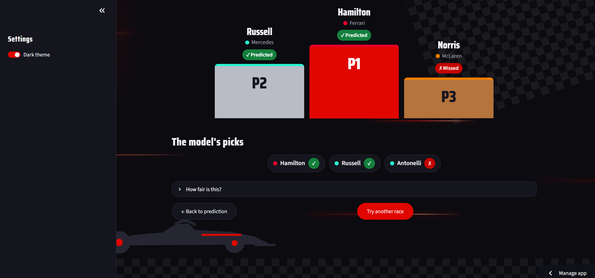
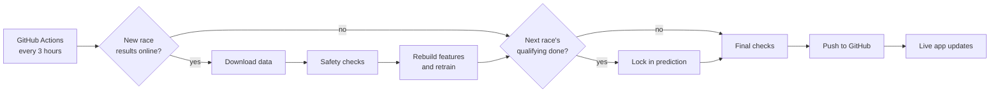
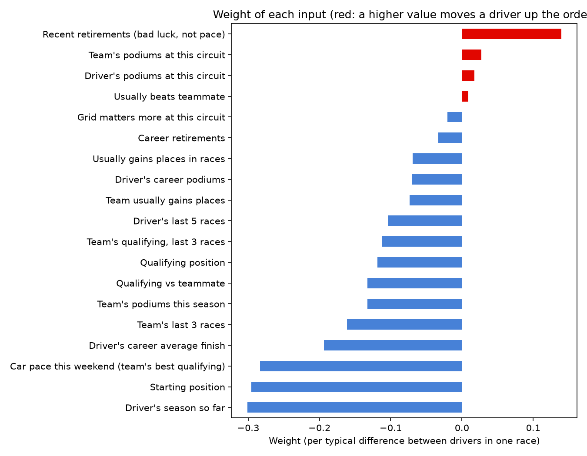

# F1 Podium Predictor


Pick a Formula 1 race and this tells you which three drivers it thinks will finish on the podium.

It's also a small live system: after every qualifying session it locks in a prediction for the race, after every race it checks the result, retrains itself and updates a public scoreboard. All of that runs automatically on GitHub Actions.

**Try it live: [f1-podium-predictor1.streamlit.app](https://f1-podium-predictor1.streamlit.app/)**



## The app

- **Predict:** pick any race since 2016 and see the model's podium, then reveal what actually happened. For upcoming 2026 races it predicts before the race, using the real qualifying grid once it's available.
- **Scoreboard:** every 2026 prediction locked in before its race, scored against the result and against a simple baseline (the front three on the grid), plus a full 2025 backtest.
- Dark and light themes, works on phones.


## How it runs itself



Every 3 hours, `src/pipeline.py` runs on GitHub's servers:

1. **After a race:** if new results are online, it downloads them, checks them, rebuilds the features and retrains the model.
2. **After qualifying:** if the next race's grid is out and its prediction isn't saved yet, it locks one in.
3. **If anything changed,** it commits and pushes, and the live app picks up the new data.

**Rules that keep the scoreboard honest:**

- A prediction is only saved with the real qualifying grid, and only before the race starts.
- Once saved, it is never changed. The pipeline checks on every run that earlier predictions are exactly as they were.
- Every prediction records which model version made it (`models/model_info.json`).

**Safety checks:** before new data is used, the pipeline checks that no rows were lost, no races or drivers are missing or duplicated, and every race has exactly one P1, P2 and P3. If any check fails, the run stops, nothing is pushed, and I get an email. The badge at the top shows whether the last run passed.

## How the model works

For every driver in a race, the model estimates their chance of finishing in the top 3. The three highest chances are the predicted podium.

It only uses things you'd know before the lights go out:

- grid and qualifying position
- each driver's and team's long-term record (podium rate, average finish, DNF rate, past results at that circuit)
- how they're doing this season
- how many places they usually gain or lose on race day

Every stat is built only from races *before* the one being predicted, so the model never gets a peek at the result it's guessing.

## Results

To keep things honest I split the data by time: trained on 2016-2022, compared models on 2023-2024, and only touched 2025 once, at the very end.

The score I care about is simple: **in an average race, how many of the 3 predicted drivers actually made the podium?**

| Model | 2023-2024 | 2025 |
|---|---|---|
| Grid baseline (first 3 on the grid) | 1.96 | 2.25 |
| Logistic Regression | 1.80 | 1.83 |
| XGBoost | 1.89 | 2.21 |
| **Random Forest (final model)** | 1.93 | **2.29** |

The baseline is brutal. Just picking the front three on the grid gets about 2 of 3 right before any machine learning happens. My final model scored **2.29 on 2025**, a season it had never seen, against 2.25 for the grid (ROC-AUC 0.949). That's a small edge, and over ~24 races a gap like that could easily be noise, so I'd call it "matches the grid, maybe slightly better" rather than a big win.

The real lesson: qualifying already tells you most of what matters on Sunday.

The 2025 backtest is in the app's Scoreboard, race by race. From round 20 of 2026, the Scoreboard also tracks predictions locked in before each race, which is the most honest test of all.

## What the model pays attention to



Grid and qualifying position dominate, followed by current-season form. Ten years of history helped less than I thought it would, which makes sense in 2026, when new regulations reshuffled the order.


## Run it yourself

```bash
git clone https://github.com/abeeryaseer24/f1-podium-predictor.git
cd f1-podium-predictor
python -m venv .venv
source .venv/Scripts/activate      # on Mac/Linux: source .venv/bin/activate
pip install -r requirements-dev.txt
```

Start the app:

```bash
streamlit run app.py
```

Rebuild everything from scratch (downloads the data, builds features, trains the model):

```bash
python src/data_loader.py
python src/features.py
python src/train.py
```

Run the live pipeline or the checks by hand:

```bash
python src/pipeline.py                     # what GitHub Actions runs every 3 hours
python src/log_prediction.py --dry-run     # preview the next race's prediction
python src/checks.py                       # run all safety checks
```

Command-line predictions:

```bash
python src/predict.py --season 2025 --round 1          # a past race
python src/predict_next.py --season 2026 --round 20    # an upcoming race
```

## Project structure

```
app.py                  the Streamlit web app
.streamlit/             app theme settings
.github/workflows/      the GitHub Actions schedule (pipeline.yml)
data/processed/         cleaned race data and features
data/predictions/       locked 2026 predictions and the 2025 backtest
notebooks/              exploration and model comparison
src/
  data_loader.py        downloads results from the Jolpica-F1 API
  features.py           builds the pre-race features
  train.py              trains, tests and saves the model, the model card and the backtest
  predictor.py          shared engine: predictions and the scoreboard
  log_prediction.py     locks in the next race's prediction
  pipeline.py           the automated live update
  checks.py             safety and fairness checks
  style.py              the app's design
  predict.py            predicts a past race (command line)
  predict_next.py       predicts an upcoming race (command line)
models/                 the saved model and its model card (model_info.json)
reports/figures/        charts and screenshots
```

## Limitations

- F1 is chaotic. Safety cars, first-lap crashes and strategy calls can't be predicted from history.
- Each driver's podium chance is estimated separately, so the chances don't add up to exactly 3 drivers.
- The live scoreboard started late in 2026, so it only has a few races so far. It keeps growing from 2027.
- Renamed teams are merged (Force India → Aston Martin, Toro Rosso → Racing Bulls and so on), so older races show today's team names.
- No weather, tyre or lap-time data yet.

## What's next

- Weather and practice-session pace from FastF1, to try to properly beat the grid
- A model that predicts the full finishing order, not just the podium
- Full driver names in the data

## Data

Race and qualifying results come from the [Jolpica-F1 API](https://github.com/jolpica/jolpica-f1), the community successor to the Ergast API.

---

Built by Talha Yaseer Abeer ([@abeeryaseer24](https://github.com/abeeryaseer24))